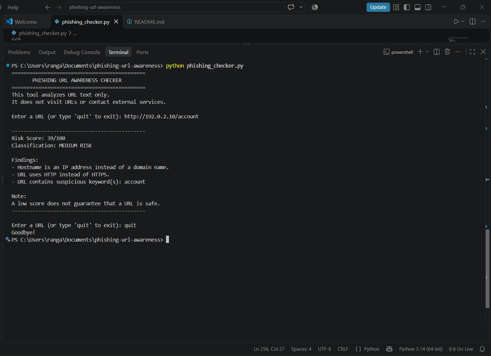
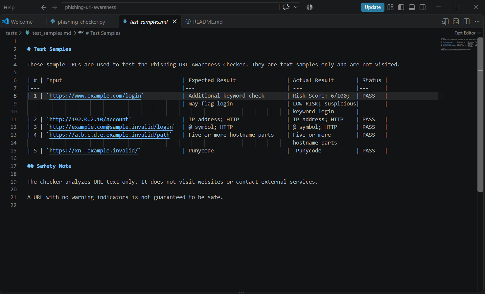

# Phishing URL Awareness Checker

## Overview

The Phishing URL Awareness Checker is a Python command-line application that analyzes URL text and identifies common phishing warning indicators.

This project is designed for cybersecurity awareness and educational purposes.

## Features

### Required URL checks

The checker identifies these six warning signs:

1. URL contains an `@` symbol.
2. URL is longer than 100 characters.
3. Hostname is an IP address.
4. Hostname contains five or more parts.
5. Hostname contains a punycode marker (`xn--`).
6. URL uses HTTP instead of HTTPS.

### Additional improvements

1. **Risk scoring and classification** — Calculates a heuristic score from 0 to 100 and classifies the URL as LOW, MEDIUM, or HIGH RISK.
2. **Additional URL indicators** — Checks for suspicious keywords, known URL shorteners, unusual ports, suspicious domain endings, encoded characters, embedded URLs, and deep paths.
3. **Input handling** — Handles empty input and allows the user to exit by typing `quit`.

## Requirements

- Python 3.10 or later
- No external Python packages required

## How to Run

Open a terminal in the project folder and run:

```text
python phishing_checker.py
```

Enter a URL when prompted.

Type `quit` to exit.

## Testing

The project uses five sample URL strings to check the required warning indicators.

Test inputs, expected results, actual results, and PASS/FAIL status are documented in `tests/test_samples.md`.

## Screenshots

Screenshots of the program and test results will be included in the `screenshots` folder.

## Limitations

This is an educational rule-based tool. It analyzes URL text only.

It does not visit URLs, scan websites for malware, or contact reputation services. Its risk score is a heuristic and is not a probability.

A URL with no detected warning indicators may still be malicious. A warning does not prove that a URL is malicious.

## Ethical Use

Use sample strings for testing. Do not collect credentials, deceive people, or test websites without permission.

## Screenshots

### Sample Run


### Test Results


## Author

RANGABABU MOTHUKURI
